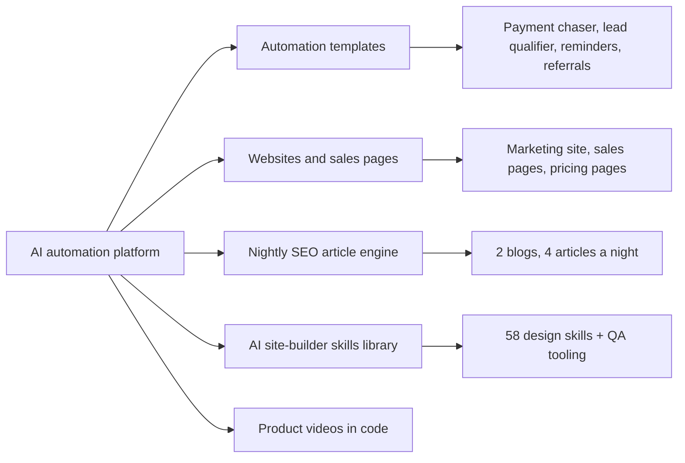
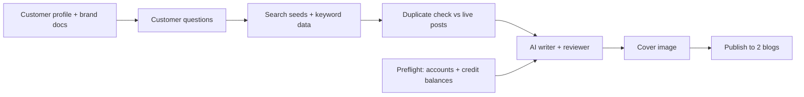

# AI Automation Platform: Templates, Websites and Content Engine

## 🚀 Overview
Four months of hands-on work (July to November 2026) for a US AI automation and content platform used by small businesses and agencies. I built installable automation templates, the platform's marketing website and sales pages, a nightly SEO article engine that publishes to two company blogs, a design-skills library for the platform's AI site builder, and product videos made entirely in code.

> **Note:** This was a client project, so the code, prompts and account details are private. This README describes what I built and how it works, with links to the live work.

## 🧩 About the Platform
The client is an all-in-one AI platform for small businesses and marketing agencies. A business sets up its profile once (brand voice, style guide, products and references), and the platform's AI uses it in everything it creates. It brings together:
- **AI assistants that know the business:** chat with AI that remembers the business's details, and share it as a web app or a website chat widget.
- **AI creation studio:** presentations, mind maps, images, infographics, documents, social posts, AI product photo shoots and AI video.
- **AI site builder:** landing pages, full websites and blogs, built and edited by chatting with the AI.
- **Workflow automation:** a visual builder that connects the business's existing tools and runs repeat work like follow-ups, reminders and reports on its own.
- **Growth tools:** business and website research, local lead lists, and social publishing with analytics.
- **Plans for single businesses and for agencies** that manage many client businesses from one account, on monthly credits.

**Where my work fits:** the automation templates run on the workflow builder, the skills library powers the AI site builder, the sales and pricing pages were built with the site builder itself, and the article engine and videos market the platform.

## 🧠 What I Worked On

### 1. Automation Templates for Small Businesses
Installable templates a non-technical owner can copy, connect and run in about ten minutes, with every business setting in one setup step and SMS consent built in.
- **Invoice and quote payment chaser:** finds unpaid invoices in Stripe, sends staged reminders and logs every step to a tracking sheet it creates on its first run. Built, tested and documented end to end.
- **Speed-to-lead qualifier:** a short SMS conversation that scores each new lead hot, warm or spam. Hot leads get a phone call bridged straight to the owner, warm leads get a booking link.
- **Appointment reminders and no-show follow-up**, and a **referral engine** that asks happy customers for referrals after a paid invoice.
- **Client setup documents** in a fixed 9-part format (problem, outcome math, step-by-step tables, install checklist) for four templates.
- **QA and platform feedback:** tested other templates node by node, reported broken connectors with working workarounds, and mapped which platform features each pending template still needed.

### 2. Websites and Sales Pages
- **Platform marketing website:** a multi-section site in Next.js with structured data, Open Graph and a sitemap, interactive sections (a before/after slider, an animated three-step explainer, hover tooltips) and many client feedback rounds, each verified on the live deploy.
- **Pages built inside the platform's own AI site builder** (by prompting it section by section, so the client can keep editing them): a launch-offer sales page, an online workshop sales page with a one-click upsell page, a service site with a booking pop-up plus a regional version, a full website rebuild, and three pricing pages.
- **Pricing pages:** comparison tables built from the client's plan spreadsheet, with 23 feature rows and a detailed tooltip on every feature. Reworked after review into three stacked comparison tables, tested in a real browser on desktop and phone.

### 3. Nightly SEO Article Engine

- Adapted an AI blog-writing plugin into a dedicated engine on GitHub Actions that writes, illustrates and publishes **two articles per blog per night** for two company blogs.
- Every article starts from the client's own customer profile and marketing documents, so posts answer real customer questions.
- **Quality and cost controls:** a preflight check of every account and credit balance before a run, a meaning-based duplicate check against live titles, title rules, and a keyword pool kept in the repo so it is not rebought every run.
- **Quality pass after client review:** 60 live titles rewritten and 41 cover images regenerated with a consistent visual style per brand.
- **Keyword research:** screened 13,200 exported keywords down to 101 on-topic ones in five rotating groups, ordered so the easiest to rank run first.

### 4. AI Site-Builder Skills Library
- **58 design skills** the platform's AI site builder reads to produce consistent, well-designed page sections, each with instructions, a working HTML block and a thumbnail.
- Zero-JavaScript components: native accordions, keyboard-friendly tabs, scroll-snap card rails and scroll-driven reveals with a static fallback.
- Every block carries its own colour variables and fallback CSS, so it renders the same with or without the site's Tailwind setup.
- Rewrote the site builder's system prompts so it picks skills by page section and follows them once loaded.

### 5. Product Videos and Motion Graphics
- Short product videos for the client, made entirely in code from real captures of the live app: HTML frames rendered with Playwright and assembled with ffmpeg, AI voice-over and music by API, 3D scenes in three.js.
- Lightweight animated backgrounds for the platform's workflow canvas in pure HTML, CSS and SVG, animating only transform and opacity, with reduced-motion support.

## 🔗 Live Work
| What | Link |
|---|---|
| Platform marketing website (Next.js) | [ideolab-website.vercel.app](https://ideolab-website.vercel.app) |
| Launch-offer sales page | [ai-growth.ideolabsites.ai](https://ai-growth.ideolabsites.ai) |
| Online workshop sales page | [aiclone.ideolabsites.ai](https://aiclone.ideolabsites.ai) |
| One-click upsell page | [aiclone-done-for-you.ideolabsites.ai](https://aiclone-done-for-you.ideolabsites.ai) |
| Video marketing service site | [videoclone.ideolabsites.ai](https://videoclone.ideolabsites.ai) |
| Website rebuild | [authority-desk.ideolabsites.ai](https://authority-desk.ideolabsites.ai) |
| Pricing pages (3 comparison tables, feature tooltips) | [ideolab.ai/pricing.html](https://ideolab.ai/pricing.html) |
| Blogs published by the nightly article engine | [ideolab.ai/blog.html](https://ideolab.ai/blog.html) and [strategicmarketer.com/blog.html](https://strategicmarketer.com/blog.html) |

Live pages may have been edited by the client's team since I handed them over.

## 🛠️ Tech Stack
- **Automation:** visual workflow builder, Stripe API, Twilio API, Google Sheets, Google Calendar, Slack
- **Web:** Next.js (App Router), TypeScript, Tailwind CSS, Framer Motion, Vercel, an AI site builder
- **Content engine:** Node.js, GitHub Actions, OpenAI API, image-generation API, Cloudinary, keyword data APIs
- **Video and visuals:** Playwright, ffmpeg, three.js, ElevenLabs API, HTML/CSS/SVG
- **Testing:** Playwright browser tests at desktop and phone widths, Python and Node check scripts

## ⚙️ How I Work
- Verify on the live page, not in the editor: every change is checked in a real browser before it is called done.
- Test every client instruction against the result, one by one, and report what is still open.
- Read every setting back after saving, so nothing is assumed.

## 🧪 Testing & QA
- 226 of 226 automated browser checks on the first skills batch, and 85 of 85 when sections were rebuilt from the written instructions alone.
- Eight rounds of handing a skill to an outside AI model to build from the text alone, each one exposing a gap that was then fixed.
- A standalone QA tester page for the skills (contrast, leftover code, undefined variables, external files).
- Pricing tooltips tested on desktop and phone: one open at a time, nothing covering them, closes on outside click.

## 🧩 Challenges Solved
- **Phone call bridge:** the platform's SMS step could only play one-way text-to-speech, so I built the owner call bridge through the Twilio API directly, sending a URL-encoded request body and an encoded plus sign so numbers were not broken.
- **Loops ending early:** a router inside a loop ended the loop on this platform, so later steps lost the current invoice. Restructured the workflow so each branch sends and logs on its own.
- **Duplicate articles:** one blog published the same article twice under two titles. Added a check that compares the planned topics with every live title by meaning.
- **Keyword spend:** the keyword pool was being rebought on most runs because of how the cache was keyed and saved. Moved the pool into the repo with a 10-day refresh.
- **Search seeds nobody searches:** the first topic prompt produced company jargon (1 of 28 seeds usable). Asking for seeds in a stranger's words raised it to 27 of 28.
- **Invisible colours:** generated sites define their own colour names, so assumed theme colours painted nothing. Each skill block now declares its own colours and renders identically with or without Tailwind.
- **Blocked deploys:** deploys were silently blocked for hours because the host only accepted commits from the project owner. Found it and fixed the commit identity.
- **Slow images:** cut the site's image payload from 10.7 MB to 1.9 MB and fixed images that never loaded on a cold edge.

## 📊 By the Numbers
- 58 site-builder skills delivered
- 4 articles published a night across 2 blogs
- 109 live blog posts by late October
- 13,200 keywords screened down to 101
- 9 pages built inside an AI site builder
- 20 platform behaviours documented with fixes
